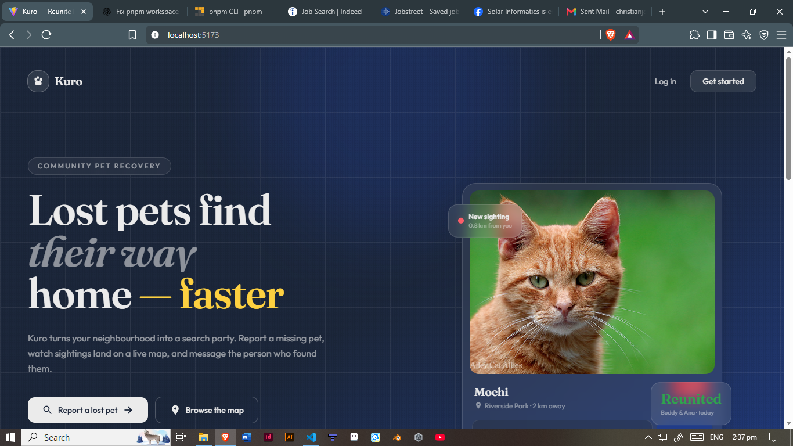
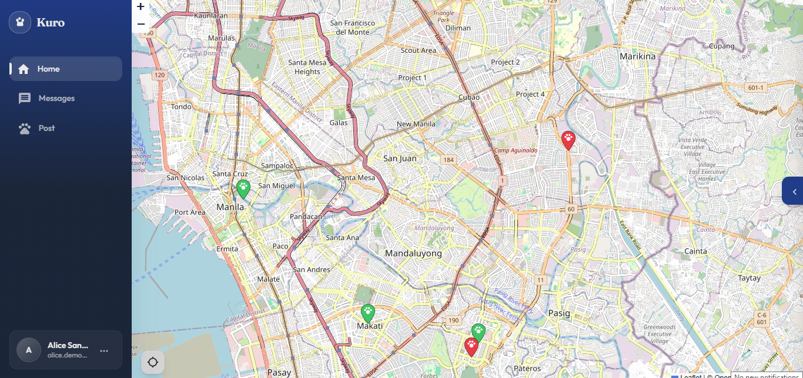
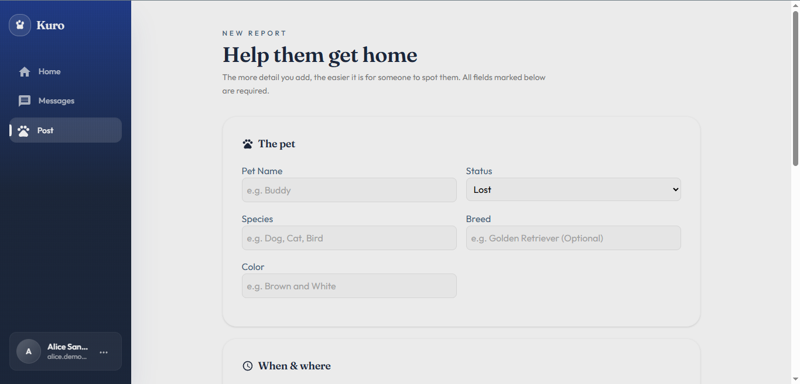
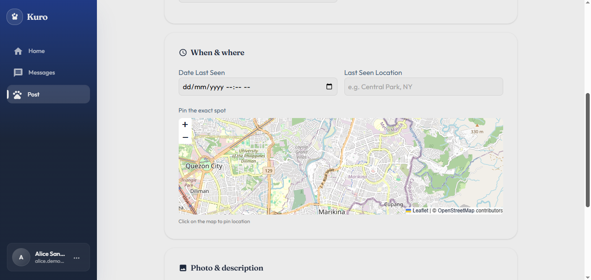

# Kuro

Kuro is a community-driven lost & found pet platform. It lets owners and good Samaritans post pet reports on a live map, sign in with Google, and receive real-time updates when new reports appear nearby.

## Screenshots






---

## Features

### Pet Reports (Lost & Found)

- Create lost-pet and found-pet reports with title, description, species, breed, and photos.
- Pin the exact location on an interactive map (Leaflet / react-leaflet).
- Reports are tagged by status (lost / found / reunited / archived).
- View reports on a map and as a feed list.

### Interactive Map

- Map-based discovery of nearby reports using Leaflet.
- Markers for each report with clickable detail popups.
- Geolocation support (with manual location fallback for denied permissions).

### Authentication

- Google Sign-In (OAuth 2.0) via browser redirect.
- Email/password registration and login.
- Secure, HTTP-only session cookies.
- Protected routes — only authenticated users can create reports.
- Session persistence across page refreshes.

### Real-Time Updates

- Socket.IO-powered live updates — new reports appear without refreshing.
- Socket connections are authenticated; identity is derived from the session, never trusted from the client.

### Report Details & Feed

- Paginated feed of reports with cursor-based "load more."
- Direct report detail pages (`GET /api/v1/pets/:id`).
- Graceful handling of archived or reunited reports.

### Tech Stack

**Client** (`client/`) — Vite + React 19 + TypeScript

- Styling: Tailwind CSS, MUI (Material UI), Styled Components, Emotion
- Maps: Leaflet + react-leaflet
- Routing: React Router DOM
- Real-time: Socket.IO Client
- Validation: Zod
- Animations: GSAP

**Server** (`server/`) — Node.js + Express + TypeScript

- Database: PostgreSQL (`pg`) with `node-pg-migrate` migrations
- Auth: JSON Web Tokens, bcrypt (password hashing), cookie-parser
- Security: helmet, cors, dotenv
- Real-time: Socket.IO
- Runner: tsx (dev), compiled Node (production)

---

## Project Structure

```
kuro/
├── README.md                 # this file
├── package.json              # root workspace scripts (one-command dev)
├── pnpm-workspace.yaml       # pnpm workspace definition
├── docs/
│   └── screenshots/          # <- put your app screenshots here
├── client/                   # React frontend (Vite, port 5173)
│   ├── src/
│   │   ├── app/
│   │   ├── assets/
│   │   ├── features/         # auth, home, pets, etc.
│   │   └── shared/
│   ├── .env                  # VITE_API_BASE_URL
│   └── package.json
└── server/                   # Node/Express backend (port 8080)
    ├── src/
    │   ├── config/
    │   ├── db/
    │   ├── features/         # auth, pets, etc.
    │   ├── middleware/
    │   ├── routes/
    │   ├── shared/
    │   └── sockets/
    ├── migrations/           # node-pg-migrate SQL migrations
    ├── .env                  # DATABASE_URL, JWT_SECRET, etc.
    └── package.json
```

---
