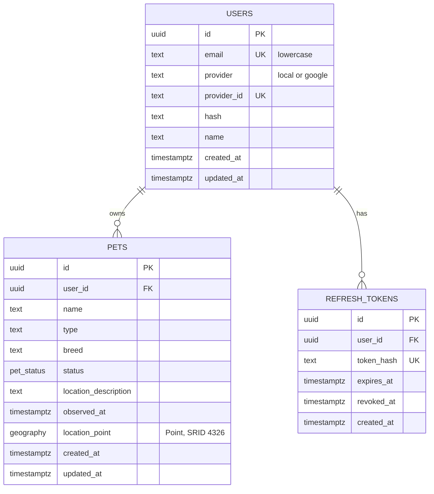

# Database decisions and ERD

## Approved decisions

- PostgreSQL uses PostGIS and `pgcrypto`; migrations are managed only through `node-pg-migrate`.
- The v1 scope is `users`, `pets`, and `refresh_tokens`; development starts from a clean database.
- Email is stored lowercase and is globally unique. A user has exactly one provider: `local` requires a password hash, while `google` requires a provider ID.
- Pet type and breed are free text. Every report requires a human-readable location and a geographic `Point` in SRID 4326.
- A report is either a lost-owner or found-finder report. `observed_at` and `location_description` are neutral fields that work for either case.
- A new report may be `draft`, `lost`, or `found`. Valid transitions are `draft → lost|found|archived`, `lost → found|archived`, `found → reunited|archived`, and `reunited → archived`.
- The normal feed includes only `lost` and `found` reports. Owners can retrieve their own records in every status.
- User deletion cascades to owned reports and refresh tokens. Removing a report means archiving it.
- Seeds run only with `npm run db:seed`; they do not run at startup or during migration.

## ERD

## Demo accounts

| Email | Password | Provider |
| --- | --- | --- |
| `alice.demo@kuro.local` | `DemoPass123!` | local |
| `ben.demo@kuro.local` | `DemoPass123!` | local |
| `gabi.demo@kuro.local` | Use Google OAuth | google |

Run `npm run db:migrate` before `npm run db:seed`.
